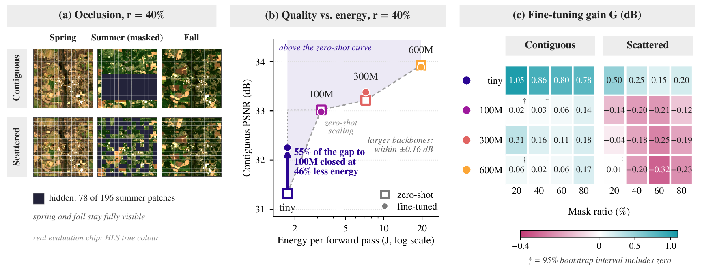

# Can Foundation Models Compensate for Incomplete Satellite Imagery?

### An Empirical Cost-Benefit Analysis

**Srija Yadav Vuppula, Lakshmish Ramaswamy, Deepak Mishra**
University of Georgia

CV4EO Workshop, WACV 2027 &nbsp;·&nbsp; [Paper](#) &nbsp;·&nbsp; [arXiv](#) &nbsp;·&nbsp; [Checkpoints](https://huggingface.co/SrijaVuppula/cloud-gap-geometry-checkpoints)



Clouds hide one contiguous region of an image, but geospatial foundation models are pretrained with patches hidden at random positions. We hide the **same number** of patches either as one block or at scattered positions, so only the arrangement differs, and test all four sizes of [Prithvi-EO-2.0](https://huggingface.co/ibm-nasa-geospatial) zero-shot and after fine-tuning, on 500 HLS time series.

- **Contiguous gaps are harder for every backbone**, by 1.6–3.0 dB of PSNR (1.4–2.0× the error). Larger backbones do not narrow the gap.
- **Fine-tuning on contiguous masks narrows the gap without closing it.** It substantially helps only the smallest backbone.
- **Fine-tuned tiny closes 54–62% of the gap to zero-shot 100M** at about half the energy per pass, and recovers its training energy after roughly one pass over the contiguous United States.

Evaluating gap filling with scattered masks therefore overstates how well these models fill cloud gaps.

---

## Reproduce the paper in two minutes (no GPU)

Every raw result is in [`results/`](results/). These commands rebuild all tables, figures and in-text numbers from it, and check them against the values printed in the paper.

```bash
git clone https://github.com/SrijaVuppula/cloud-gap-geometry && cd cloud-gap-geometry
pip install -r requirements-analysis.txt
make paper     # tables/, figures/, and every number in the text (printed by section)
make test      # asserts Tables 1-4 and Figure 1c match the paper
```

| Paper | Made by | Output |
|---|---|---|
| Table 1 — zero-shot PSNR and geometry gap Δ | `analysis/tables.py` | `tables/table1_zeroshot.{md,tex}` |
| Table 2 — Δ after fine-tuning | `analysis/tables.py` | `tables/table2_finetuned_gap.{md,tex}` |
| Table 3 — energy per pass, training cost | `analysis/tables.py` | `tables/table3_cost.{md,tex}` |
| Table 4 — crossover point N* | `analysis/tables.py` | `tables/table4_crossover.{md,tex}` |
| Figure 1 — occlusion, quality vs. energy, gain G | `analysis/fig1_overview.py` | `figures/fig1_overview.pdf` |
| Figure 2 — PSNR vs. distance to visible context | `analysis/fig2_distance.py` | `figures/fig2_distance.pdf` |
| Figure 3 — crossover, tiny vs. 100M | `analysis/fig3_crossover.py` | `figures/fig3_crossover.pdf` |
| Numbers in Sections 5.1–5.3 | `analysis/paper_numbers.py` | printed |
| Medians, bootstrap CIs, Spearman ρ | `analysis/compute_stats.py` | `results/derived/` |

## Full reproduction (GPU)

Everything below writes to `runs/` and never overwrites the released `results/`. Evaluation scripts compare their PSNR with the released values when they finish. Times are for one NVIDIA RTX 3090 (24 GB).

**1. Install and download** (11 GB archive; 2,554 chips are extracted)

```bash
pip install -r requirements.txt            # Python 3.11, terratorch 1.2.6
python scripts/00_download.py              # HLS chips + Prithvi-EO-2.0 TL weights
python scripts/00_download.py --finetuned  # optional: our fine-tuned checkpoints
python scripts/01_make_splits.py           # checks splits/ against the dataset
```

**2. Zero-shot evaluation** (Section 5.1). 500 chips × 4 ratios × 5 trials × 2 geometries per backbone.

```bash
python scripts/02_evaluate.py --backbone tiny        # or: make eval-zs
```

**3. Fine-tuning and evaluation** (Section 5.2). 4 backbones × 10 runs, about 52 h of training in total.

```bash
python scripts/03_finetune.py --backbone tiny --seed 1
python scripts/02_evaluate.py --backbone tiny --finetuned --seed 1
bash scripts/run_all_finetuning.sh                   # all 40 runs, resumable
```

**4. Energy** (Sections 4.5, 5.3). Needs NVML; values depend on the GPU.

```bash
python scripts/04_measure_energy.py                          # released weights
python scripts/04_measure_energy.py --order reversed         # measurement-uncertainty check
python scripts/04_measure_energy.py --finetuned --seed 1     # fine-tuned weights
```

**5. Patch-level and chip-level analyses** (Section 5.1, Figure 2)

```bash
python scripts/05_patch_distance.py --backbone tiny  # error vs. distance to visible context
python scripts/06_chip_complexity.py                 # edge density, spatial std, entropy
```

To rebuild the tables and figures from your own runs, copy `runs/*` over `results/` and run `make paper`.

## Repository layout

```
configs/default.yaml     every setting used in the paper (paths can be set with CLOUDGAP_* env variables)
splits/                  500 evaluation chips, 2,004/50 fine-tuning split, logged trial seeds
src/cloudgap/            masking, model loading, data, metrics, NVML sampling
scripts/                 00_download → 06_chip_complexity (GPU pipeline)
analysis/                statistics, tables, figures, paper numbers (CPU)
results/                 released raw outputs
  zeroshot/              per-trial PSNR, results_{backbone}.csv
  finetuned/seed{1-10}/  same, for each fine-tuning run
  training/seed{1-10}/   training logs and energy
  energy/                energy per pass (mJ): zero-shot, reversed order, fine-tuned
  distance/              per-patch error by distance d (trial 0; fine-tuned = run 1)
  chip_complexity.csv
  derived/               produced by analysis/compute_stats.py
tests/                   paper values and masking protocol
```

## Protocol notes

- **Matched masks.** Only the summer acquisition is masked; spring and fall stay fully visible. Both geometries hide exactly the same number of patches (`build_paired_masks` in `src/cloudgap/masking.py`).
- **TerraTorch token budget.** TerraTorch sets one masking budget over all three frames. We give the chosen summer patches the highest noise and pass `n_hidden / total_tokens` as the mask ratio. At r = 60% and 80% on the 196-patch grid, TerraTorch's truncation hides one extra token, usually in spring or fall. Both geometries hide the same extra token, and it changed PSNR by at most 0.011 dB (paper, footnote 1). Keep `terratorch==1.2.6`.
- **Trial seeds.** The trial seeds were drawn once with Python's per-process string hash. They are logged in `splits/trial_seeds.csv` and replayed by every evaluation, so all configurations see identical masks.
- **Patch size.** tiny, 100M and 300M use 16-pixel patches (196 per frame); 600M uses 14-pixel patches (256 per frame).
- **No metadata.** Acquisition date and location are never given to the model, in evaluation or fine-tuning.
- **Energy** is board power × time on one GPU running near its 350 W cap. Fine-tuned models use the zero-shot energy per pass for N* (Section 5.3).
- **Fine-tuning split.** The 2,004/50 train/validation draw was made once and is released as is. `01_make_splits.py` checks that it exactly partitions the pool left after the evaluation chips and their neighbours are removed.

## Data and models

- [HLS Multi-Temporal Crop Classification](https://huggingface.co/datasets/ibm-nasa-geospatial/multi-temporal-crop-classification) (IBM and NASA): 224 × 224 chips at 30 m, three 2022 acquisitions, six bands.
- [Prithvi-EO-2.0](https://huggingface.co/ibm-nasa-geospatial) TL weights, tiny / 100M / 300M / 600M (IBM and NASA, Apache-2.0).
- Our fine-tuned checkpoints: [SrijaVuppula/cloud-gap-geometry-checkpoints](https://huggingface.co/SrijaVuppula/cloud-gap-geometry-checkpoints).
- Models are loaded through [TerraTorch](https://github.com/IBM/terratorch).

## Citation

```bibtex
@inproceedings{vuppula2027cloudgap,
  title     = {Can Foundation Models Compensate for Incomplete Satellite Imagery? An Empirical Cost-Benefit Analysis},
  author    = {Vuppula, Srija Yadav and Ramaswamy, Lakshmish and Mishra, Deepak},
  booktitle = {Proceedings of the IEEE/CVF Winter Conference on Applications of Computer Vision (WACV) Workshops},
  year      = {2027}
}
```

## License

Code and released results: [Apache-2.0](LICENSE). The HLS dataset and the Prithvi-EO-2.0 weights are distributed by their owners under their own terms.
